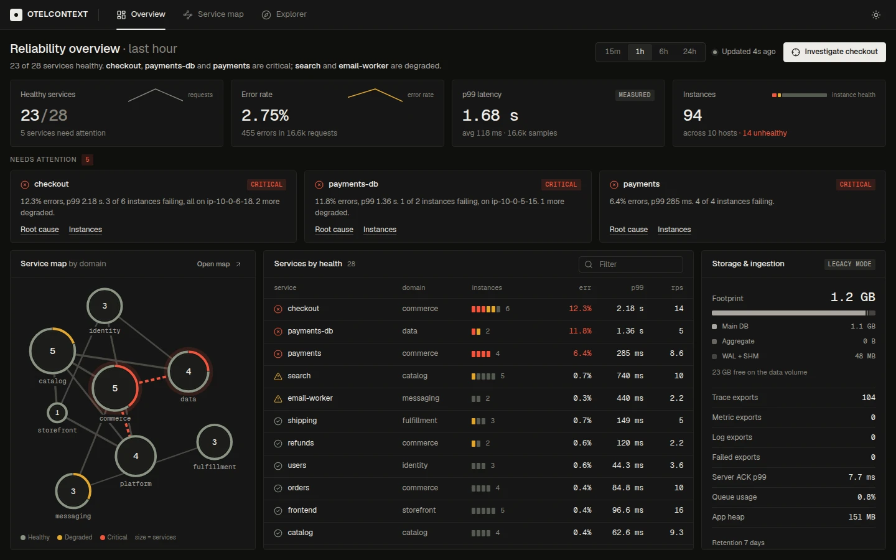

<div align="center">
  

  <h1>OtelContext</h1>

  <p><strong>Turn traces, logs, and metrics into one clear view of your services.</strong></p>
  <p>Self-hosted OpenTelemetry collection, incident triage, and service mapping in one Go binary.</p>

  <p>
    <a href="https://github.com/RandomCodeSpace/otelcontext/releases"></a>
    <a href="https://github.com/RandomCodeSpace/otelcontext/actions/workflows/ci.yml"></a>
    <a href="https://github.com/RandomCodeSpace/otelcontext/actions/workflows/security.yml"></a>
    <a href="LICENSE.md"></a>
  </p>
</div>



OtelContext helps you answer the question that starts most incidents: **what is broken, and what does it affect?** Send it standard OpenTelemetry data and it connects service relationships, errors, latency, logs, and traces in a map built for investigation.

It starts with SQLite and no external services. When you need more, the main telemetry database can use PostgreSQL, MySQL, or SQL Server.

> [!IMPORTANT]
> OtelContext is pre-1.0. Read the [changelog](CHANGELOG.md) before upgrading.

## What you get

- **A live service map** that shows dependencies, health, latency, and active anomalies.
- **Incident context in one place** with related traces, logs, metrics, and impact analysis.
- **Ten MCP tools** for investigating your system from an AI client or coding agent.
- **Standard OTLP input** over gRPC and HTTP, so existing SDKs and Collectors can send data directly.
- **A simple first run** with one binary and a local SQLite database.
- **Self-hosted data** with retention controls, health probes, and Prometheus metrics.

## Quick start

### 1. Install a release

Download the archive for your platform from [GitHub Releases](https://github.com/RandomCodeSpace/otelcontext/releases), or install the latest release with Go:

```bash
go install github.com/RandomCodeSpace/otelcontext@latest
```

### 2. Start OtelContext

```bash
otelcontext
```

That is enough for a local trial. OtelContext creates `OtelContext.db`, listens for OTLP gRPC on `4317`, and serves the UI and HTTP endpoints on `8080`.

Open **[http://localhost:8080](http://localhost:8080)**.

Authentication is off by default so the browser UI works immediately. Keep this first run on your machine. Before exposing it to a network, follow [Secure a deployment](#secure-a-deployment).

### 3. Send telemetry

Point an OpenTelemetry SDK or Collector at either endpoint:

| Protocol | Endpoint |
|---|---|
| OTLP gRPC | `localhost:4317` |
| OTLP HTTP | `http://localhost:8080/v1/traces`, `/v1/logs`, or `/v1/metrics` |

To confirm the connection without setting up an application, send one sample error log:

```bash
curl -fsS http://localhost:8080/v1/logs \
  -H "Content-Type: application/json" \
  -d "{
    \"resourceLogs\": [{
      \"resource\": {\"attributes\": [{
        \"key\": \"service.name\",
        \"value\": {\"stringValue\": \"readme-demo\"}
      }]},
      \"scopeLogs\": [{\"logRecords\": [{
        \"timeUnixNano\": \"$(date +%s)000000000\",
        \"severityNumber\": 17,
        \"severityText\": \"ERROR\",
        \"body\": {\"stringValue\": \"OtelContext is receiving data\"}
      }]}]
    }]
  }"
```

ERROR is used because the default storage threshold keeps WARN and ERROR logs.

<details>
<summary><strong>OpenTelemetry Collector example</strong></summary>

Save this as part of your Collector configuration. Replace `otelcontext` with the host or service name running OtelContext.

```yaml
receivers:
  otlp:
    protocols:
      grpc:
        endpoint: 0.0.0.0:4317
      http:
        endpoint: 0.0.0.0:4318

processors:
  batch: {}

exporters:
  otlp/otelcontext:
    endpoint: otelcontext:4317
    tls:
      insecure: true

service:
  pipelines:
    traces:
      receivers: [otlp]
      processors: [batch]
      exporters: [otlp/otelcontext]
    logs:
      receivers: [otlp]
      processors: [batch]
      exporters: [otlp/otelcontext]
    metrics:
      receivers: [otlp]
      processors: [batch]
      exporters: [otlp/otelcontext]
```

For an authenticated deployment, add an `authorization` bearer header and, if needed, `x-tenant-id` under the exporter.

</details>

## Service and instance map

Open **`/service-map`**, or use **Service & instance map** in the existing
explorer. Choose an environment and time range, then apply the filters. Select
a service to load its one- or two-hop neighborhood; **Inspect instances**
expands the observed callers and dependencies into individual instances.
Selecting a node or directed call edge opens its identity, traffic, average
latency, and errors in the inspector. Refresh is manual.

Send these **resource attributes** from each application:

| Attribute | Purpose |
|---|---|
| `service.name` | Logical service, shared by its replicas |
| `service.namespace` | Separates services with the same name in different applications |
| `service.instance.id` | Distinguishes each running copy |
| `deployment.environment.name` | Separates Dev, Test, and other environments |
| `host.id` or `host.name` | Displays the latest reported host placement |

The legacy `deployment.environment` attribute is also accepted. Missing
environments appear under **Unknown**; host names never determine an environment.
Calls require trace parent/child context propagated between applications.
Sharing a host creates no call edge. Calls between two instances of the same
service remain visible in the instance view.

The map works with SQLite and PostgreSQL in both legacy and aggregate modes.
Run `otelcontext migrate up` with the deployment's database configuration before
starting the new binary: additive schema version **6** creates
`topology_entities` and `topology_buckets`. Existing history is preserved, but
old telemetry cannot supply instance identities that were never retained.
MySQL and SQL Server retain the existing explorer; the new topology API reports
that this projection is unavailable.

Topology is a **best-effort visualization**, built from accepted traces before
exemplar sampling. It stores five-minute summaries in the main database, with
the configured `HOT_RETENTION_DAYS`. Summaries flush every five seconds and on
graceful shutdown; a crash may lose the unflushed interval. Parent joins and
retry deduplication last five minutes in memory and reset on restart.
Host-only identities are marked unresolved; explicit instance IDs, or a host
plus workload identity, distinguish copies. Metrics-only and logs-only
resources can appear without invented call edges or trace rates.

Reads are limited to 24 hours, 40 displayed nodes by default (100 maximum),
200 edges, and 50,000 stored summary rows per request. Environment and
neighborhood filters run before the storage read. The process retains at most
20,000 node/edge identities and 100,000 correlation spans. The UI reports
truncated results, incomplete identities, and limited evidence. These bounds
do not establish a load-tested performance or disk-size guarantee.

**Storage & ingestion** separates the main database, aggregate database, and
both databases' WAL/SHM files. Sizes include indexes and reusable space, not
just retained payloads. Export counters count successful OTLP requests,
including partial-success responses, since process start; they are not event
counts. Server ACK p99 uses the latest 1,024 successful exports and excludes
network time. Memory is Go heap allocation. These stats are server-wide;
topology reads remain tenant-scoped. The backing endpoints are
`/api/topology/catalog`, `/api/topology/graph`, and `/api/stats/runtime`.

## Query ingested metrics with PromQL

### Local database (no Prometheus server)

Enable the embedded upstream PromQL engine over original metric samples stored
in OtelContext's **main SQLite or PostgreSQL database**:

```dotenv
PROMQL_LOCAL_ENABLED=true
PROMETHEUS_URL=
PROMETHEUS_TENANT_ID=default
HOT_RETENTION_DAYS=7
```

Apply `otelcontext migrate up` with the same database configuration before
starting the new binary. Schema version 5 adds `promql_series` and
`promql_samples`; existing tables and summarized history are preserved. The
usual database backup includes the new tables. Production startup checks the
schema without migrating it.

The local backend needs no separate process, port, or server. OTLP metric ACKs
require a successful database commit, and local storage participates in
readiness. It reuses the existing `PROMETHEUS_TIMEOUT_MS` and concurrency settings
listed below. `PROMETHEUS_REQUIRED=false` does not make local persistence
optional. Local mode and `PROMETHEUS_URL` are mutually exclusive. As with the
external backend, this initial implementation binds queries and metric writes to
`PROMETHEUS_TENANT_ID` (default: `DEFAULT_TENANT`); other tenants retain their
existing ingestion path and cannot query this backend.

Original samples are retained **from activation onward**. Older metric buckets
and aggregate sketches cannot reconstruct original samples, counter resets, or
labels, so they are not exposed as fabricated PromQL history. Queries use a
consistent database snapshot and exclude expired samples even before the hourly
retention worker deletes them. Local retention follows `HOT_RETENTION_DAYS`,
independently of raw trace/log exemplar retention.

The upstream Prometheus 3.15.0 Go engine and OTLP converter (Apache-2.0) provide
query and conversion semantics. Names and labels retain UTF-8/dots. Resource
attributes and instrumentation scope are preserved as series labels. Gauges,
cumulative counters, classic histogram buckets, native exponential histograms,
and summary series are supported. **Delta sums and histograms are rejected**;
configure cumulative SDK export. Queries use millisecond timestamps and the
standard five-minute lookback. Identical series/timestamp retries are
idempotent; a different value at the same timestamp rejects the whole batch.

Local requests have additional fixed work bounds: 10,000 input datapoints and
10,000 translated samples per export; 8 MiB of translated sample/label payload;
128 labels and 16 KiB of labels per series; 64 KiB per encoded sample. Samples
outside retention or over five minutes in the future are rejected. Queries
inspect at most 10,000 candidate series across selectors, select at most 1,000
series per selector, read at most 100,000 samples / 32 MiB of payload, and use
the engine's 100,000-sample evaluation bound. Excess work returns an explicit
error rather than partial aggregates. Narrow selectors or query intervals when
these bounds are reached. HTTP range queries also enforce 11,000 steps.

Full-resolution metric storage consumes additional database space, including
indexes and WAL. These request limits are not a total disk quota. Existing
aggregate-mode capacity measurements do not establish this backend's storage
or ingestion performance; size retention for the actual metric volume.

### External backend (optional alternative)

Set `PROMETHEUS_URL` with `PROMQL_LOCAL_ENABLED=false` to use an external backend.
With both disabled, ingestion and metric reads keep their legacy local paths.
The `/metrics` scrape reports OtelContext's own health and counters; both PromQL
backends query application and host metrics received through OTLP.

Configure Prometheus with its native OTLP receiver enabled and this configuration:

```yaml
global:
  scrape_interval: 1m
otlp:
  translation_strategy: NoTranslation
  promote_resource_attributes:
    - service.name
    - service.instance.id
    - host.id
    - host.name
```

Start Prometheus with `--web.enable-otlp-receiver`, set its retention explicitly
with `--storage.tsdb.retention.time=7d`, and bound query work with
`--query.max-samples=100000 --query.timeout=10s`. The reference integration test
uses Prometheus 3.15.0. Prometheus owns metric retention and storage; OtelContext's
local retention settings do not control that backend.

Then configure OtelContext:

```dotenv
PROMETHEUS_URL=http://127.0.0.1:9090
PROMETHEUS_TENANT_ID=default
PROMETHEUS_REQUIRED=false
```

| Setting | Default | Meaning |
|---|---|---|
| `PROMETHEUS_URL` | empty | HTTP(S) base URL; no embedded credentials, query, or fragment |
| `PROMETHEUS_TENANT_ID` | `DEFAULT_TENANT` | The only tenant allowed to write or query this backend |
| `PROMETHEUS_REQUIRED` | `false` | Require backend acceptance before local metric processing and include the backend in `/ready` |
| `PROMETHEUS_TIMEOUT_MS` | `10000` | Request deadline, including ingest admission; range 1..30000 |
| `PROMETHEUS_MAX_CONCURRENT` | `8` | Active queries and metadata reads; range 1..64 |
| `PROMETHEUS_MAX_INGEST_CONCURRENT` | `16` | Separate active metric forwarding slots; range 1..256 |
| `PROMETHEUS_MAX_INGEST_WAITERS` | `256` | Exporters waiting for an ingest slot; range 1..4096 |

Use a dedicated backend for the configured tenant. Tenant binding gates access
to the entire backend; it does not add tenant label filters to PromQL. Existing
tenant precedence applies. Other tenants keep local ingestion and metric reads,
and their PromQL requests are refused before reaching the backend.

Forwarding preserves the original OTLP metric names, resource and point
attributes, timestamps, units, histogram payloads, and exemplars before local
projection. **Send cumulative sums and histograms.** Delta sums and histograms
are refused by this backend contract. No delta conversion or metric renaming
runs in OtelContext. With `NoTranslation`, dotted names and label keys need
quoted selectors, for example `{__name__="system.cpu.utilization","host.name"="node-a"}`.
Promote additional resource attributes in Prometheus if queries need them as labels.

In optional mode, forwarding failures leave local ingestion running and return
an OTLP partial-success warning; missing backend data is not queued for replay.
In required mode, backend outages return retryable gRPC `RESOURCE_EXHAUSTED` or
HTTP 429 before local accounting. Invalid backend input returns gRPC
`INVALID_ARGUMENT` or HTTP 400. A successful backend write followed by a local
projection failure returns a warning when the backend accepted all resources.
Backend partial-success rejections are preserved and must not be retried. Local
projection skips the forwarded resources in that case because the backend does
not identify individual rejected points. `/ready` probes backend availability
only when required; it does not validate retention, OTLP enablement, or translation.

HTTP query endpoints accept GET parameters or POST form data:

```bash
curl -fsSG http://localhost:8080/api/v1/query \
  --data-urlencode 'query={__name__="system.cpu.utilization","host.name"="node-a"}'
curl -fsSG http://localhost:8080/api/v1/query_range \
  --data-urlencode 'query={__name__="system.cpu.utilization"}' \
  --data-urlencode 'start=2026-10-18T00:00:00Z' \
  --data-urlencode 'end=2026-10-19T00:00:00Z' \
  --data-urlencode 'step=5m'
```

Responses preserve Prometheus envelopes, labels, timestamps, result types,
warnings, and backend errors. `GET /api/metadata/metrics` discovers retained
metric names, with optional `service_name`, `start`, and `end` filters. The
existing `GET /api/metrics?name=...` view returns evaluated scalar samples for
the bound tenant, marked `sampled` with `OtelContext-Metric-Source: local` or `prometheus`.
It cannot flatten native histograms; use PromQL for those. Host service names
use `host/<host.id>`, falling back to `host.name` when no host ID is available.

MCP advertises `promql_query` and `promql_query_range` through `tools/list`.
They return uncached Prometheus envelopes and share MCP's concurrency, timeout,
and response-size bounds. `resources/list` advertises the readable
`OtelContext://system/graph` resource; the internal scrape is not an MCP resource.

The client caps query parameters at 64 KiB, query ranges at seven days, returned
series at 1,000, and backend responses at 8 MiB. Each forwarded request is capped
at 64 MiB; active and waiting exports share a 128 MiB protobuf wire-size budget.
Encoding happens after admission. This budget does not cover incoming network
decoding or total process memory. Readiness has its own slot. MCP further caps
query text at 16 KiB, evaluation points at 11,000 per series, and results at its
existing 4 MiB response limit. Prometheus must also enforce its own query and storage
limits. This optional feature does not certify 200-service production capacity.

## Investigate with MCP

Connect an MCP client to `http://localhost:8080/mcp` to investigate the same telemetry from an agent. The tools can:

- Build an anomaly timeline.
- Show the service map and service health.
- Analyze likely root causes and downstream impact.
- Reconstruct a trace graph.
- Search logs with bounded results.

Trace-based answers say whether the supporting exemplar is complete, partial, or no longer retained. OtelContext does not present a partial trace as the whole story.

## Upgrade without guessing

The same binary can check and upgrade its database before it starts any receiver or background work:

```bash
./otelcontext migrate status
./otelcontext migrate up
```

If the database came from an older release that predates migration tracking, identify it once before upgrading:

```bash
./otelcontext migrate baseline --from v0.3.1
# or: --from v0.4.0-beta.2
./otelcontext migrate up
```

The baseline command validates the database first; it does not repair or guess. Create a complete OtelContext backup before upgrading, and keep the previous signed binary until `migrate status` reports `result=ready`. Versioned production checks are available for SQLite and unpartitioned PostgreSQL 16. MySQL, SQL Server, and PostgreSQL daily partitioning keep their existing preview AutoMigrate path.

For a one-host Linux deployment, use the shipped [systemd unit and environment example](deploy/systemd/) and follow the [install, upgrade, and rollback runbook](docs/OPERATIONS.md#supported-systemd-deployment). Direct execution remains supported for local use.

## Back up and restore

After stopping OtelContext cleanly, use the same binary and environment as the service:

```bash
otelcontext backup create --out /absolute/path/to/backups
```

The published bundle keeps the main database, any mode-required aggregate database, the dead-letter queue, generated TLS identity, and a hashed manifest together. Restore into new database and sidecar paths; the command will not overwrite the source or an existing target:

```bash
otelcontext backup restore --bundle /absolute/path/to/backups/otelcontext-backup-...
```

Restore starts the same candidate briefly, waits for `/ready`, and shuts it down again. Keep the old binary, configuration, data, and bundle until the restored deployment passes your checks. The [backup and restore runbook](docs/OPERATIONS.md#backup--restore) covers database-specific tools, fresh-target setup, validation, and rollback.

## Secure a deployment

With no authentication or TLS settings configured, production mode starts without either:

```bash
APP_ENV=production ./otelcontext
```

Authentication is optional. Enable it when the deployment boundary requires a credential:

- `API_KEY` for a shared operator credential.
- `AUTH_TRUST_EXTERNAL=true` when a trusted reverse proxy owns authentication and tenant identity.

Authenticated example:

```bash
export API_KEY="$(openssl rand -hex 32)"
./otelcontext
```

Clients then send `Authorization: Bearer <key>`. Authentication and TLS are independently optional at runtime; configure each one when the deployment boundary requires it.

The browser UI does not currently store an API key. For an authenticated browser deployment, put OtelContext behind a same-origin proxy that authenticates the user and injects the credential for REST, MCP, and WebSocket traffic.

See the [operations guide](docs/OPERATIONS.md) for database, TLS, retention, proxy, and health-check setup.

## Common configuration

OtelContext reads environment variables and an optional `.env` file in its working directory.

| Setting | Default | Use it for |
|---|---|---|
| `HTTP_PORT` | `8080` | UI, REST, OTLP HTTP, MCP, WebSockets, and probes |
| `GRPC_PORT` | `4317` | OTLP gRPC |
| `DB_DRIVER` | `sqlite` | `sqlite`, `postgres`, `mysql`, or `sqlserver` |
| `DB_DSN` | `OtelContext.db` | Database connection string |
| `API_KEY` | empty | Shared bearer authentication |
| `DEFAULT_TENANT` | `default` | Scope used when no trusted tenant is supplied |
| `HOT_RETENTION_DAYS` | `7` | Main retention horizon |
| `STORE_MIN_SEVERITY` | `WARN` | Lowest log severity stored in the main database |
| `AGGREGATE_MODE` | `legacy` | `legacy`, `aggregate-shadow`, or `aggregate` |

Start with [`.env.example`](.env.example). The default `legacy` mode is the right choice for a first run. Aggregate modes are for measured high-volume deployments; review the [aggregate gate report](docs/gates/2026-08-23-aggregate-7day-gate.md) before enabling them.

<details>
<summary><strong>Build from source</strong></summary>

Use the Go version in `go.mod`:

```bash
git clone https://github.com/RandomCodeSpace/otelcontext.git
cd otelcontext

CGO_ENABLED=0 go build -o otelcontext .
```

The client-rendered UI is committed as plain HTML, CSS, and JavaScript and is embedded automatically. There is no Node.js install or frontend build step.

Run the core checks with:

```bash
go build ./...
go vet ./...
go test -race -timeout 180s ./...
```

</details>

## Project links

- [Releases](https://github.com/RandomCodeSpace/otelcontext/releases)
- [Changelog](CHANGELOG.md)
- [Operations guide](docs/OPERATIONS.md)
- [Contributing](CONTRIBUTING.md)
- [Security policy](SECURITY.md)
- [Aggregate design glossary](CONTEXT.md)
- [Release gate protocol](docs/gates/README.md)

## License

OtelContext is available under the [MIT License](LICENSE.md).
